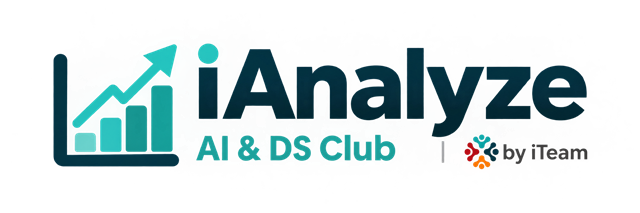

  <picture>
    <source media="(prefers-color-scheme: dark)" srcset="frontend/src/assets/brand/ianalyze-on-dark.png">
    
  </picture>

# iAnalyze Academy

A bilingual learning platform for aspiring data analysts, built as an iAnalyze initiative under iTEAM at Al-Zaytoonah University of Jordan.

**[🌐 Visit Live Website](https://ianalyze-academy.pages.dev/)** · [GitHub Repository](https://github.com/khaled-amireh/ianalyze-academy)

## About the project

iAnalyze Academy helps students explore data analysis through accessible learning resources, structured guidance, and a collaborative academic community. It brings together the educational work of iAnalyze, an initiative under iTEAM at Al-Zaytoonah University of Jordan, in one bilingual platform.

## Key features

### Public learning experience

- **Arabic and English:** translated content with RTL/LTR text handling. The approved layout keeps its RTL structure across languages while English text reads left to right.
- **Responsive design and themes:** mobile-friendly layouts, light/dark themes, and saved language and theme preferences.
