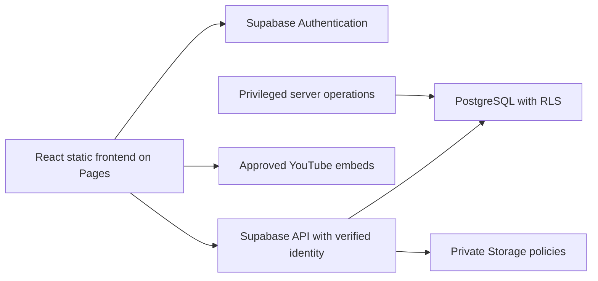

# Conceptual data and security architecture

Planning only: no SQL, migrations, Supabase project, policies, keys, or backend connections are created. This document describes future enforcement obligations.

## System boundaries

Only the publishable project key may be in a future frontend. Privileged/service-role secrets remain server-side. Client claims, route guards, editable profile metadata and browser role selectors are not authorization. Bootstrap the first Leader through a controlled operator procedure, then audited server-side grants; deny self-escalation. Use MFA for privileged accounts where feasible. Revoke assignments and sessions promptly on role changes.

## Entities, ownership and relationships

| Entity | Relationships / conceptual fields | Ownership and visibility |
| --- | --- | --- |
| profiles | auth user 1:1; private name, display alias, preferred language, major | Own limited edits; assigned staff access only necessary fields; no public profile dump |
| role_assignments | user → role; grantor, grant/revoke timestamps | Leader-controlled; client cannot write roles |
| registration_applications | optional verified applicant user; contact fields, privacy version/time, decision | Applicant sees own status after verification; Leader decisions; Organizer denied by default |
| organizer_assignments | Organizer ↔ student/activity scope; grantor; expiry | Leader grants; reviewed on every resource query |
| activities | fixed-program activity/project, bilingual text, release/deadline, file policy, rubric version | Leader edits; students see released activities only |
| rubric_versions / rubric_criteria | activity 1:many immutable versions; criteria, caps, ordered bilingual labels | Published criteria visible before submission; draft editing restricted |
| submissions | student + activity 1:many attempts; object key, server timestamp, state, lateness/extension | Student owns attempts; assigned Organizer reads; Leader reads all authorized program records |
| project_teams / memberships | final project group → members; linked attempt, submitter | Optional conceptual support pending team grading/ownership decision; private member scope |
| reviews / grade_criteria_scores | submission → reviewer draft → approval/publish versions; rubric references, feedback | Assigned Organizer drafts; Leader approves; student sees only own published result |
| participation_awards | student, documented reason, capped award, approver | Staff writes through approved flow; student sees own; no arbitrary client point edits |
| announcements | bilingual content, audience, draft/published timestamps, author | Authorized audience only; Leader publishes |
| achievements / user_achievements | definition → awarded student, evidence, approver | Student own record; public only with explicit applicable consent |
| leaderboard_preferences | user 1:1; opt-in false by default, approved alias, consent version/time | Own choice; public projection contains only opted-in alias, approved total/rank, permitted badges |
| internal_documents | private object reference, version, authorized audience | Leader/authorized Organizer only; document bytes never in frontend repository |
| audit_events | actor, action, target, time, reason; no file payload | Append-only controlled writes; Leader audit access; avoid unnecessary PII |

There is deliberately **no courses table or course-management model** in this initial design. Activities reference the fixed EDA program identity/configuration, not a user-created catalog. Aggregate statistics must avoid re-identification in small cohorts.

## Permission matrix

“Assigned” means an explicit, current server-checked delegation; no implicit organization-wide authority.

| Capability | Visitor / applicant | Student | Organizer | Leader/Admin |
| --- | --- | --- | --- | --- |
| Public pages / Student Syllabus | Read | Read | Read | Read / approved content editing |
| Registration | Apply; own verified status only | Own historical application | No review rights by default | Review / decide |
| Student profile | None; own application only | Own limited fields | Necessary assigned-student fields | Necessary program records |
| Internal Team Syllabus | Denied | Denied | Authorized staff read | Read / controlled replacement |
| Released activities / rubrics | Public syllabus overview only | Read released content | Read assigned work | Create/edit/release fixed-program activities |
| Submission upload | Denied | Own eligible activity/attempt | No uploading as student | No impersonation upload by default |
| Submission read / download | Denied | Own | Assigned only | Authorized program scope |
| Grade draft / edit | Denied | Denied | Assigned drafts only | Review / approve / publish / correct with audit |
| Feedback | Denied | Own published feedback | Write assigned drafts | Review and publish |
| Leaderboard | Opted-in public projection only | Own private rank + public projection | Authorized progress + public projection | Audit approved totals; no arbitrary public edits |
| Announcements | Published public only | Published student/public | Published team/public; no publishing by default | Draft/publish by audience |
| Registration approval | Denied | Denied | Denied | Allowed |
| Role / assignment management | Denied | Denied | Denied | Audited secure grant/revoke |

## Enforcing isolation in Phase 01

RLS deny-by-default on all personal/operational tables. Check authenticated user ID against ownership and current role/assignment records. Column/operation restrictions must prevent a student updating grades, accepted status, roles or system timestamps through an otherwise allowed profile update. Organizer access joins assignments to the exact student/activity/submission. Permission checks must also cover download endpoints, storage objects, aggregates, views, RPC/functions, and exports. A filtered frontend list is insufficient.

Public leaderboards need a narrowly defined projection that cannot leak base-table records or bypass RLS through unsafe view/function privileges. Approval and publish transitions should be atomic, idempotent, validated server-side, and audited. Public content and rubric text need safe rendering; never inject untrusted HTML.

Private Storage keys: opaque server-authorized identifiers with owner/activity/attempt metadata; names are not security. Short-lived authorized download URLs, no public bucket, no permanent shared links. Never execute uploaded notebooks. Force safe download/content disposition; inspect type, extension, size and notebook structure server-side. Proposed default `.ipynb` only, 2 MiB; optional `.py`/`.pdf` and 5 MiB project cap need approval. Reject executables, HTML, archives and unexpected formats. Handle partial object/record writes and clean authorized orphan files.

Propose two retained attempts per activity plus any documented appeal exception; do not silently delete accepted evidence. Owner must approve retention dates, post-program archive/deletion, data export process, account deletion, backup custody, and legal/privacy wording before collection. No external Team Syllabus content has been copied into this repository. The preview's private-document panel is a generic restricted-access placeholder only.

## Required future authorization tests

Unauthenticated access to private document/submission; Student A reading/updating Student B; a student setting grades/role/acceptance; Organizer accessing unassigned student, application or role; expired/revoked assignment; leaked download link expiration; draft feedback leakage; opt-out removal from public projection; concurrent duplicate publication; upload cap/type bypass. These tests are planned and **not executed**, because there is no backend in Phase 00.
