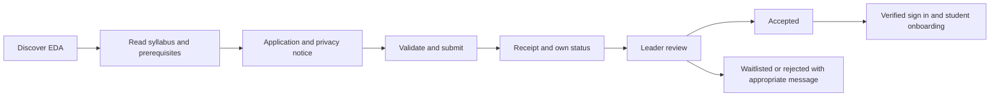
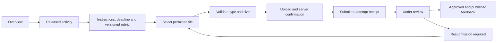

# User experience flows

All flows describe future behavior. Preview controls never send data. Each write needs explicit confirmation of its result, retry-safe processing, and backend authorization.

## Visitor → application → acceptance

User supplies proposed fields; university ID stays omitted unless necessity is approved. Privacy acknowledgement is required; public ranking consent is separate and off by default. Validation retains safe user input on transient failures, identifies each error, and offers retry without duplicate applications. A duplicate email leads to a neutral status/recovery path, not disclosure of another person's application. Application acceptance and account verification are distinct. A pending/rejected account has no submission access. No email sender has been selected yet.

## Student → submission → feedback

Not Submitted is an activity/student state, not an empty submission row. Submitted, Under Review, Reviewed and Resubmission Required are workflow states. Late is a **separate deadline flag**, so a late submission can also be Reviewed. A server timestamp determines lateness in Asia/Amman. Before upload, show accepted types, size cap, actual deadline/timezone, and a visible rubric. Do not mark Submitted until storage and metadata are confirmed. Interrupted uploads show retry and preserve the current confirmed attempt. No overwriting history. Locked/closed activity explains how to request help through an approved contact channel. A resubmission request includes a reason and new deadline if granted. Unpublished draft scores remain invisible to students.

## Organizer → grading

Organizer signs in → assigned queue → authorization check → authorized file download → rubric criteria → written feedback → save draft → submit for Leader approval. An unassigned submission has no accessible URL. The review header shows the exact attempt and rubric version. Saving and submitting are separate actions; invalid scores identify the criterion. Concurrent review changes require conflict resolution, not silent overwrite. An Organizer cannot approve their own role or publish final totals by default. The Team Syllabus entry is a private document boundary, not a static asset link.

## Approved grades → points → leaderboard

Leader reviews a submitted draft → approves → publishes → future backend produces one approved contribution per assessment and capped participation → private total updates → opted-in alias enters public ranking. Preview totals are fixed sample literals and never computed from input. Proposed shared-rank ties, late rules, resubmissions and appeals are detailed in `product-requirements.md`. Revoking publication or correcting a grade triggers a versioned recomputation with audit history. A student's prior-Python answer never contributes to points. The public view exposes no email, ID, per-activity grades, files, feedback, or private rankings. Opt-out removes the public entry while preserving private progress.

## Leader → announcement → student

Leader drafts bilingual title/body → selects student/team/public audience → previews in both languages → validates required translations → publishes → authorized dashboard displays announcement → optional read acknowledgement. Drafts are private; audience constraints apply in queries, not just rendering. Correction records a changed timestamp. Failed publication leaves a draft and offers retry. Notifications are supplementary; the dashboard remains the source of truth.

## Cross-cutting states and recovery

| State | Design response |
| --- | --- |
| Empty | Explain what is absent and the safe next step; no fake activity or contact links |
| Loading | Short localized text with `role=status`, skeleton hidden from assistive technology, no layout jump |
| Success | Persistent receipt/state in context; never only a disappearing toast |
| Error | Plain localized cause and retry/help action; keep last confirmed data visibly distinct |
| Session expired | Sign in again; never expose private content through stale public cache |
| Permission denied | Explain restricted access without disclosing another student's details |
| Offline | Label stale read-only data and block misleading submissions |

The static Activity view includes a localized state selector to review empty/loading/success/error appearance. It changes presentation only.
